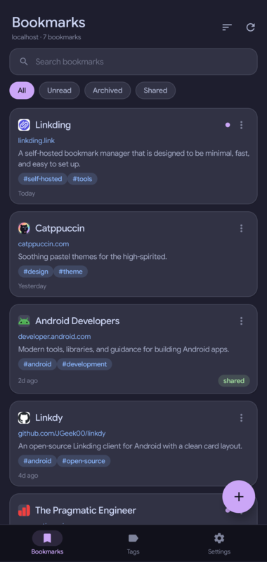
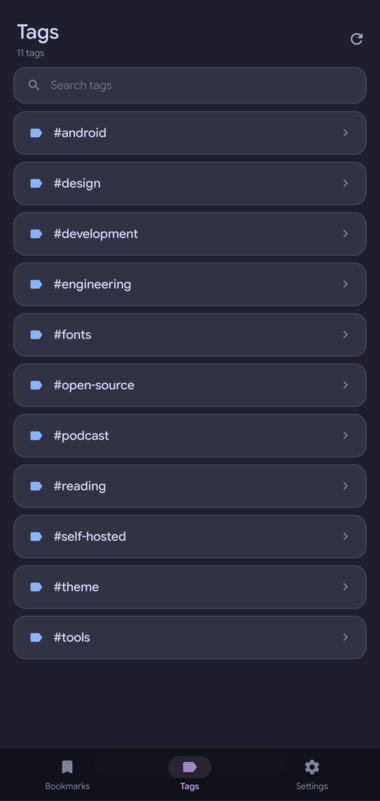
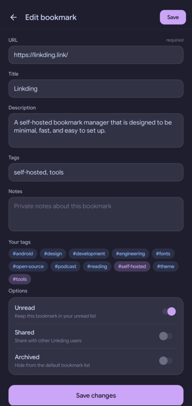
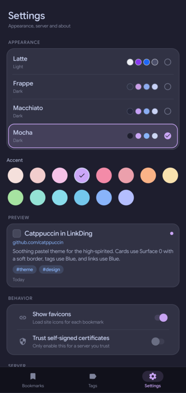

<p align="center">
  
</p>

<h1 align="center">LinkDing for Android</h1>

<p align="center">
  A calm, native Android client for your self-hosted
  <a href="https://github.com/sissbruecker/linkding">Linkding</a> server.
</p>

<p align="center">
  
  
  
</p>

LinkDing is a small, dependency-light Android app for browsing and managing a
[Linkding](https://github.com/sissbruecker/linkding) bookmark collection. It is
written in Java against the Android framework and does not use AndroidX,
Jetpack Compose, or a third-party runtime library.

The interface follows the [Catppuccin](https://catppuccin.com/) palette, with
four flavors and fourteen accents. Bookmarks are presented as rounded cards
with favicons, tags, relative dates, and clear unread/shared/archived badges.

## Features

- Connect to any Linkding instance with a server URL and API token.
- Save multiple accounts and switch between servers from Settings.
- Browse bookmarks with pull-to-refresh and paginated infinite scrolling.
- Filter by **All**, **Unread**, **Archived**, or **Shared**.
- Search bookmarks, or browse and search the tag list; tapping a tag filters
  the bookmark feed.
- Sort by newest, oldest, recently modified, or title.
- Add and edit bookmarks with URL, title, description, tags, notes, and
  unread/shared/archived state.
- Duplicate-URL detection through the Linkding check endpoint.
- Bookmark actions: open in browser, edit, mark read/unread, archive,
  unarchive, share, copy link, and delete.
- Receive links from Android's share sheet.
- Four Catppuccin flavors (Latte, Frappé, Macchiato, Mocha) and fourteen
  accent colors, with a live preview in Settings.
- Optional favicon loading and self-signed certificate support.
- Test the server connection or disconnect from Settings.
- No analytics, ads, tracking, or external account.

## Screenshots

Screenshots use a mock Linkding server with sample bookmarks.

| | |
|:---:|:---:|
| <br>**Bookmarks** | <br>**Tags** |
| <br>**Bookmark editor** | <br>**Appearance** |

## Install

Prebuilt APKs are published on the
[Releases](https://github.com/arifnurrohim/linkding-client/releases) page when
available.

To install a locally built APK:

```bash
adb install -r LinkDing.apk
```

Or copy `LinkDing.apk` to the device and open it.

The app requires Android 8.0 (API 26) or newer. It targets API 36.

## Connect to Linkding

1. Open your Linkding server and create an API token in the user settings.
2. Launch LinkDing and enter the server URL, for example
   `https://linkding.example.com`.
3. Paste the API token and tap **Connect**.
4. If your server uses a self-signed certificate, enable **Trust self-signed
   certificates** only when you trust the server and network.

The token is stored in the app's private `SharedPreferences` store. Android
backup is disabled for the app. The token is only sent to the configured
Linkding server in the `Authorization` header.

## Build from source

The project uses a plain shell build script instead of Gradle. The script
compiles resources with `aapt2`, compiles Java with `javac`, converts classes
with `d8`, injects `classes.dex`, aligns the APK, and signs it.

### Requirements

- JDK 17 or newer (Java 21 is tested).
- Android SDK Platform 36 or newer (`android.jar`).
- Android SDK Build-Tools with `aapt2`, `d8`, `zipalign`, and `apksigner`.
- Python 3.
- Bash.

### Linux and macOS

```bash
export ANDROID_HOME="$HOME/Android/Sdk"
export ANDROID_JAR="$ANDROID_HOME/platforms/android-36/android.jar"
./build.sh
```

If the build-tools are not on `PATH`, point the script at them:

```bash
export BUILD_TOOLS="$ANDROID_HOME/build-tools/36.0.0"
./build.sh
```

### Termux

Make sure `aapt2`, `d8`, `zipalign`, `apksigner`, `keytool`, `javac`, and
`python3` are available, then set `ANDROID_JAR` to your platform jar:

```bash
export ANDROID_JAR="/path/to/android.jar"
./build.sh
```

### Output and signing

The script writes the signed APK to `LinkDing.apk`. If `linkding.keystore`
does not exist, it creates a development keystore with the password `android`.
That default key is convenient for local testing but should not be used for a
public release.

For release builds, provide your own key through environment variables:

```bash
export KEYSTORE="/secure/path/linkding-release.keystore"
export KEY_ALIAS="linkding"
export STORE_PASS="your-store-password"
export KEY_PASS="your-key-password"
export VERSION_CODE="2"
export VERSION_NAME="1.1.0"
./build.sh
```

Never commit a keystore or its passwords. The included `.gitignore` excludes
keystores, APKs, and build output.

## Automated builds and releases

Two GitHub Actions workflows are included:

| Workflow | Trigger | Result |
| --- | --- | --- |
| `Build` | Push to any branch, pull request, or manual run | Development-signed APK artifact |
| `Release` | Push a `v*` tag | Signed APK and SHA-256 checksum on GitHub Releases |

The development workflow uses a throwaway key and is only intended for testing.
The release workflow requires your release keystore and publishes the APK to a
GitHub Release automatically.

### Configure release signing

Add these repository secrets under **Settings → Secrets and variables →
Actions**:

| Secret | Required | Description |
| --- | --- | --- |
| `KEYSTORE_BASE64` | Yes | Base64-encoded release keystore |
| `KEYSTORE_PASSWORD` | Yes | Keystore password |
| `KEY_ALIAS` | No | Key alias (defaults to `linkding`) |
| `KEY_PASSWORD` | No | Key password (defaults to the keystore password) |

Encode the keystore on Linux:

```bash
base64 -w0 linkding.keystore > linkding.keystore.b64
```

On macOS:

```bash
base64 -i linkding.keystore | tr -d '\n' > linkding.keystore.b64
```

Paste the contents of `linkding.keystore.b64` into the `KEYSTORE_BASE64`
secret, then delete the temporary file. Keep a secure backup of the keystore
and its passwords.

Use the same keystore for every release so Android can install updates over the
previous version. Never commit the keystore to the repository.

### Publish a release

```bash
git tag v1.0.0
git push origin v1.0.0
```

The tag must use semantic versioning: `v1.2.3`, optionally with a suffix such
as `v1.2.3-beta.1`. The workflow uses the tag name as `versionName` and the
commit count as a monotonically increasing `versionCode`.

It creates a GitHub Release named `LinkDing 1.2.3`, uploads
`LinkDing-1.2.3.apk`, and includes a `.sha256` checksum. Release notes are read
from the matching section of [`CHANGELOG.md`](CHANGELOG.md). Re-running the
workflow for the same tag replaces the existing assets and notes.

## API compatibility

LinkDing uses the Linkding REST API:

| Purpose | Endpoint |
| --- | --- |
| List bookmarks | `GET /api/bookmarks/` |
| List archived bookmarks | `GET /api/bookmarks/archived/` |
| List shared bookmarks | `GET /api/bookmarks/shared/` |
| Check an existing URL | `GET /api/bookmarks/check?url=...` |
| Create a bookmark | `POST /api/bookmarks/` |
| Update a bookmark | `PATCH /api/bookmarks/{id}/` |
| Delete a bookmark | `DELETE /api/bookmarks/{id}/` |
| Archive / unarchive | `POST /api/bookmarks/{id}/archive/` and `/unarchive/` |
| List tags | `GET /api/tags/` |

Authentication uses `Authorization: Token <token>`.

## Project structure

```text
src/main/java/app/arifnurrohim/linkding/
  Api.java                  Linkding REST client
  Bookmark.java             Bookmark model
  BookmarkAdapter.java      Bookmark card list adapter
  Catppuccin.java           Palettes and accents
  ConnectActivity.java      Server setup
  Dialogs.java              Sheets and confirmation dialogs
  EditBookmarkActivity.java Add/edit form
  FaviconLoader.java        Favicon download and cache
  MainActivity.java         Bookmarks, tags, and navigation
  Prefs.java                App settings and credentials
  SettingsPage.java         Settings UI
  Theme.java                System bars, insets, and window styling
  Ui.java                   Shared view helpers
src/main/assets/            Material Icons font and license
src/main/res/               Icons, strings, and resources
.github/workflows/          CI build and tagged release workflows
docs/icon.png               README icon
docs/screenshots/           README screenshots
build.sh                    Build, align, and sign script
tools/make_icons.py         Optional launcher icon generator
```

## Privacy notes

- Bookmark data comes from, and is written back to, your Linkding server.
- There is no LinkDing backend, telemetry, or analytics.
- When **Show favicons** is enabled, the hostname of each visible bookmark is
  sent to Google's favicon service (`google.com/s2/favicons`) to fetch an icon.
  Disable the option if you do not want that request.
- **Trust self-signed certificates** disables normal TLS certificate and
  hostname validation for the Linkding connection. Leave it off unless you
  understand the risk.
- Cleartext HTTP is allowed so local/self-hosted servers can be used. Prefer
  HTTPS whenever possible.

## Credits

- [Linkding](https://github.com/sissbruecker/linkding) by Sascha Ibruegger.
- [Linkdy](https://github.com/JGeek00/linkdy) by JGeek00, the visual and
  interaction inspiration for this app.
- [Catppuccin](https://github.com/catppuccin/catppuccin) for the color system
  and style guide.
- [Material Icons](https://github.com/google/material-design-icons) by Google,
  used under the Apache License 2.0.

LinkDing is not affiliated with Linkding or Linkdy.

## Contact

- Website: [arifnurrohim.my.id](https://arifnurrohim.my.id/)
- Email: [jobs.arifnurrohim@gmail.com](mailto:jobs.arifnurrohim@gmail.com)
- Telegram: [@Inheritation](https://t.me/Inheritation)

## License

Project code is released under the [MIT License](LICENSE). The bundled
Material Icons font remains under the Apache License 2.0; see
[`src/main/assets/materialicons.LICENSE`](src/main/assets/materialicons.LICENSE).
